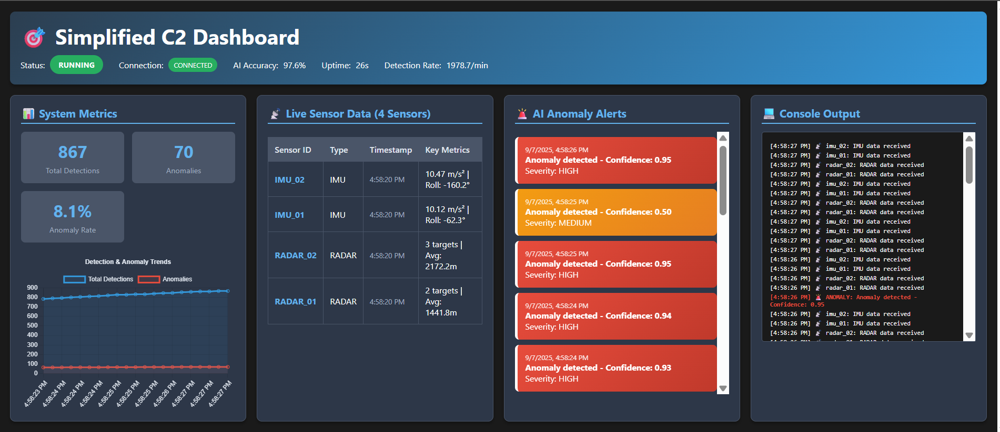

# Simplified Command & Control (C2) Node System

A Python-based UDP sensor simulation and AI anomaly detection system with a real-time web dashboard.

## Features
- **Sensor Simulation:** Generates synthetic data for 4 sensors (2 radar, 2 IMU) and GPS, sent via UDP.
- **AI Inference:** Uses a RandomForestClassifier to detect anomalies in sensor data with >85% accuracy.
- **Logging:** Logs sensor summaries and AI decisions to CSV files in the `logs/` directory.
- **Web Dashboard:** Real-time dashboard (Flask + SocketIO) for monitoring system status, sensor data, and AI alerts.
- **API Endpoints:** Start/stop system, fetch status, sensor data, and alerts via REST API.

## Project Structure
```
main.py                # Main application: sensor sim, AI, dashboard, API
requirements.txt       # Python dependencies
env/                   # Python virtual environment
        Scripts/           # Activation and Python executables
        Lib/               # Installed packages
        Include/           # Python include files
logs/                  # Data logs
        ai_decisions.csv   # AI decision logs
        sensor_data.csv    # Sensor data logs
```

## How It Works
- **SensorSimulator:**
    - Simulates radar and IMU sensors, plus GPS.
    - Sends data via UDP to the C2 system.
- **AIInferenceService:**
    - Trains a RandomForest model on synthetic data.
    - Extracts features and predicts anomalies in real time.
- **DataLogger:**
    - Logs sensor summaries and AI decisions to CSV files.
- **SimplifiedC2System:**
    - Listens for UDP sensor data, runs AI inference, updates dashboard, and exposes REST API.
    - Web dashboard displays live metrics, sensor data, and AI alerts.

## Setup & Usage
1. **Create and activate virtual environment** (already present as `env/`).
2. **Install dependencies:**
     ```powershell
     .\env\Scripts\activate
     pip install -r requirements.txt
     ```
3. **Run the system:**
     ```powershell
     python main.py
     ```
     - Dashboard available at: http://localhost:8081
     - Use API endpoints to control/start/stop system.

## API Endpoints
- `/api/status` — System status and metrics
- `/api/sensors` — Latest sensor data
- `/api/alerts` — Recent AI anomaly alerts
- `/api/start` — Start system (POST)
- `/api/stop` — Stop system (POST)

## Logging
- Sensor summaries: `logs/sensor_data.csv`
- AI decisions: `logs/ai_decisions.csv`

## Contributing
- Fork, clone, and push changes via GitHub.
- Ensure all dependencies are listed in `requirements.txt`.

## Screenshot 
